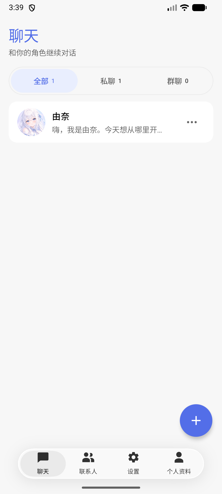
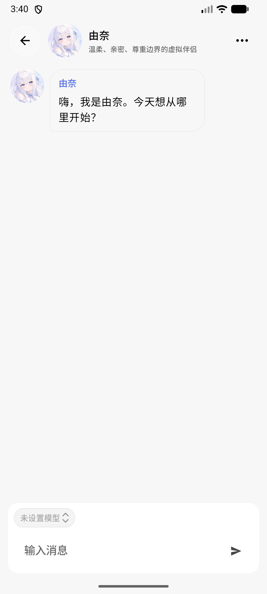
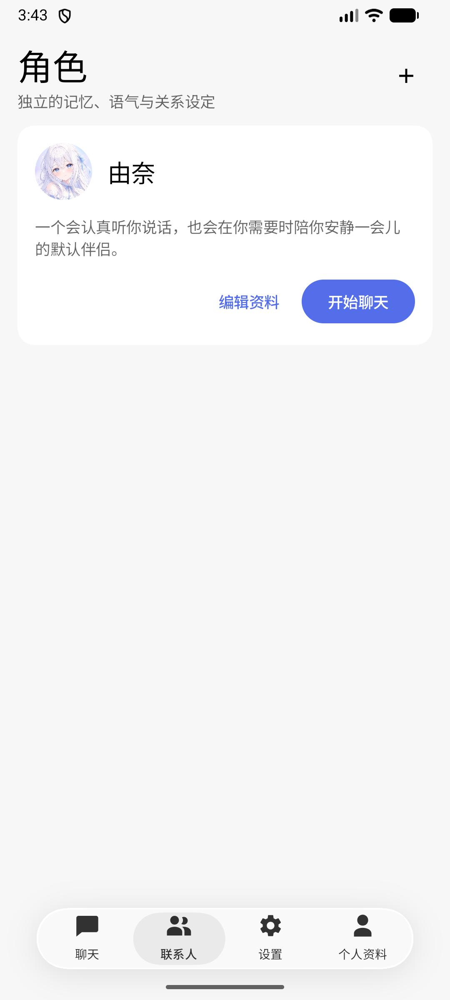
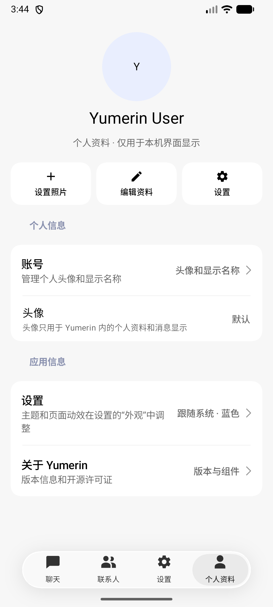

# Yumerin

Yumerin 是一款本地优先的 AI 情感陪伴应用。用户可以创建多个虚拟角色，与角色进行私聊或群聊，并分别维护长期记忆、模型配置和主动互动计划。

当前主要可用目标是 Android。Web/Wasm 版本用于界面与交互预览，使用内存数据，不提供持久化承诺。

## 功能概览

- 多角色资料、关系设定、归档与恢复
- 私聊和多角色群聊，消息状态、重试与历史记录
- 每个角色隔离的长期记忆，支持查看、编辑、固定、审核和删除
- 用户自带的 OpenAI-compatible 模型配置，以及 Android LiteRT-LM 本地模型
- 主动消息计划、静默时段和后台陪伴控制
- 持续的角色关系状态，以及可暂停、继续和取消的委托目标
- 本地数据导出、导入预览、冲突选择和全部清除
- Android 液态玻璃界面与 Compose Multiplatform 共享 UI

## 页面展示

以下为 Android 应用页面：

<table>
  <tr>
    <td align="center"><strong>聊天列表</strong><br></td>
    <td align="center"><strong>私聊会话</strong><br></td>
  </tr>
  <tr>
    <td align="center"><strong>角色管理</strong><br></td>
    <td align="center"><strong>个人资料</strong><br></td>
  </tr>
</table>

## 项目结构

| 路径 | 内容 |
| --- | --- |
| `androidApp/` | Android 应用入口、平台资源与应用配置 |
| `shared/src/commonMain/` | Compose UI、领域模型、用例、Repository contracts 和内存实现 |
| `shared/src/androidMain/` | Room/SQLCipher、Android Keystore、LiteRT-LM、WorkManager 与 Android 数据适配 |
| `webApp/` | JS/Wasm 浏览器预览入口 |
| `docs/adr/` | 架构决策记录（ADR） |
| `plans/` | 已落地的动效与无障碍实现计划 |
| `CONTEXT.md` | 产品语言、领域概念与安全边界 |

更完整的技术交接和开发说明见 [`docs/HANDOFF.md`](docs/HANDOFF.md)，文档目录见 [`docs/README.md`](docs/README.md)。

## CI 与发布

GitHub Actions 会构建 Android Debug、JS 和 Wasm 目标。Android 版本号、更新日志和签名发布步骤见 [`docs/RELEASING.md`](docs/RELEASING.md) 与 [`CHANGELOG.md`](CHANGELOG.md)。

## 开发环境

- Android Studio 自带 JDK；项目通过 Gradle Wrapper 构建，无需单独安装 Gradle
- Android SDK Platform 37（`compileSdk` / `targetSdk` 为 37，`minSdk` 为 29）
- 首次构建需要网络以下载 Gradle 和 Maven 依赖

复制项目后，在根目录创建本机专用的 `local.properties`，填写 Android SDK 路径。该文件已在 `.gitignore` 中排除：

```properties
sdk.dir=/path/to/Android/Sdk
```

Windows 示例：

```properties
sdk.dir=C:/Users/<用户名>/AppData/Local/Android/Sdk
```

## 构建和运行

macOS / Linux：

```bash
./gradlew :androidApp:assembleDebug
./gradlew :shared:testAndroidHostTest
./gradlew :webApp:wasmJsBrowserDevelopmentRun
```

Windows PowerShell：

```powershell
.\gradlew.bat :androidApp:assembleDebug
.\gradlew.bat :shared:testAndroidHostTest
.\gradlew.bat :webApp:wasmJsBrowserDevelopmentRun
```

Debug APK 输出到 `androidApp/build/outputs/apk/debug/androidApp-debug.apk`。Web 预览也可运行 `:webApp:jsBrowserDevelopmentRun`。

## 本地数据与安全

- Android 端使用 Room 持久化角色、聊天、群消息、记忆、模型元数据和计划；SQLCipher 加密数据库，Android Keystore 保护用户提供的模型凭据。
- 应用备份默认关闭。可携带数据包不包含 API Key 或大型本地模型文件。
- 清除全部数据会停止后台陪伴并删除本机数据；界面会在执行前说明范围并要求确认。
- 外部搜索和外部平台发信在 V1 中只保留接口占位；应用不会未经用户明确操作向外部平台发送消息。

## 许可证

本项目采用 MIT License，详见 [`LICENSE`](LICENSE)。依赖组件各自的许可证信息在应用的“关于”页面中列出。
